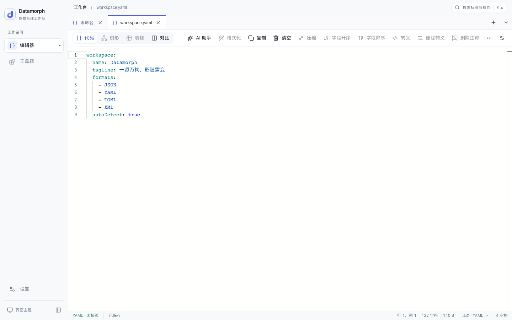
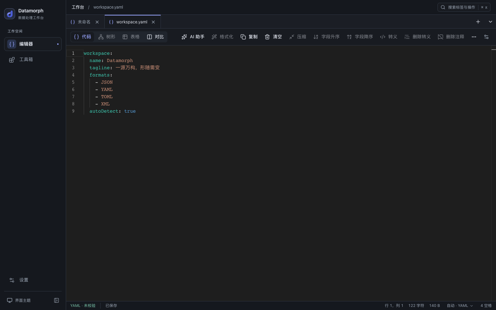

<div align="center">
  
  <h1>Datamorph</h1>
  <p><strong>一源万构，形随需变 · 数据处理工作台</strong></p>
  
  [](https://opensource.org/licenses/MIT) [](https://github.com/fevrax/datamorph/stargazers) [](https://reactjs.org/) [](https://www.typescriptlang.org/) [](https://vitejs.dev/) [](https://tailwindcss.com/) [](https://nodejs.org/)
  
</div>

## ✨ 特性

- 自动识别并高亮 JSON、JSONC、JSON5、YAML、TOML、XML、CSV、TSV、INI、NDJSON、HTML、CSS、SCSS、LESS、SQL、JavaScript、TypeScript、Markdown、Protobuf（含 `.yml`、`.jsonl`、`.proto`）。默认自动模式，也可手动固定语言；导入文件或明确命名的扩展名优先。
- 空白和无法判断的内容默认 JSON，格式切换保留正文、撤销记录及光标位置。
- 支持多格式识别、高亮、编辑和文本对比。格式化支持 JSON/JSON5、JSONC、YAML、HTML、CSS/SCSS/LESS、SQL（标准 SQL）、JavaScript/TypeScript、Markdown 和 Protobuf，可从工具栏、快捷键及对比视图使用并撤销；校验、树形、表格及 JSONPath 仍限 JSON/JSON5。TOML、XML、CSV、TSV、INI、NDJSON 暂不提供编辑器格式化；已有格式转换工具支持 JSON、JSON5、YAML、TOML、XML。
- Protobuf 编辑视图提供“重新排序编号”：按字段出现顺序为每个 message 从 1 开始重新编号，oneof 共用所属 message 的序列，嵌套 message 独立编号，并跳过 reserved、extensions 和 19000–19999。保留排版、注释、枚举值及选项，支持撤销；此操作会改变字段在二进制协议中的标识。
- 默认根据内容自动识别空格或 Tab 缩进，粘贴、导入和格式化时沿用已有缩进；对比视图两侧独立识别。没有可识别缩进时使用全局默认宽度，可在编辑器设置中关闭自动识别并手动指定宽度。
- 首次升级自动迁移原有文档、历史、设置与 AI 配置，保留旧数据库；清除数据后不会重新导入。

Datamorph 是面向开发者的数据处理工作台。以同一份数据为源，按需求编辑、对比和转换不同结构。

- 🚀 **多视图模式**：支持文本视图、树形视图、差异对比视图和表格视图
- 🎨 **深色/浅色主题**：适应各种工作环境和个人偏好
- 🔄 **视图切换**：快速在不同视图模式间切换
- 🧩 **多标签页**：支持同时打开多种格式的数据文件处理
- 🧩 **丰富工具箱**：集成多种专用JSON处理工具
- 🔎 **JSONPath 查询**：字段提取、条件筛选、递归查询，内置交互示例与[使用指南](docs/jsonpath.md)
- 🔍 **字符解码器**：自动识别并解码常见编码格式
- 🤖 **AI驱动功能**：利用AI技术增强JSON处理体验

## 📦 JSON 工具箱

<div align="center">
  <table>
    <tr>
      <td align="center">
        
        <br />
        <strong>JSON AI 修复</strong>
        <br />
        <small>AI智能修复JSON格式错误</small>
      </td>
      <td align="center">
        
        <br />
        <strong>对象类型转换器</strong>
        <br />
        <small>JSON转TS/Go/Java/Rust等</small>
      </td>
      <td align="center">
        
        <br />
        <strong>数据格式转换</strong>
        <br />
        <small>JSON/YAML/XML/TOML互转</small>
      </td>
      <td align="center">
        
        <br />
        <strong>JWT解析验证</strong>
        <br />
        <small>解析JWT令牌与验证签名</small>
      </td>
    </tr>
  </table>
</div>

## 🖼️ 界面预览




## 🔥 核心功能

### 多格式编辑器与 JSON 结构视图

- **文本视图**：基于Monaco Editor的专业代码编辑体验
- **树形视图**：直观的树状结构展示，适合数据浏览
- **差异对比视图**：方便对比JSON数据差异
- **表格视图**：以表格形式展示JSON数据

### JSONPath 查询

在代码编辑器底部输入 `$.users[*].name` 等表达式即可实时查看结果，也可从工具箱打开「JSONPath 查询」练习页。支持 RFC 9535 语法、匹配数量、结果复制及差异预览后替换。

查询结果始终为数组。旧 JSON Query 的管道、`map()`、`sort()` 等语法不再适用；完整示例、数字精度限制与迁移说明见 [JSONPath 使用指南](docs/jsonpath.md)。

### 字符解码解码器

- **时间戳解码器**：自动识别并将时间戳转换为可读日期时间格式
- **Base64解码器**：检测并解码Base64编码字符串
- **Unicode解码器**：自动解码Unicode转义序列为可读字符
- **URL解码器**：识别并解码URL编码的字符串
- **可配置性**：支持全局或按编辑器实例单独启用/禁用解码器

### JSON AI 修复

- **自动修复**：使用jsonrepair库自动修复常见格式错误
- **AI智能修复**：借助OpenAI API进行更复杂的JSON修复

## 🐳 Docker 部署

### 使用 Docker Compose（推荐）

```bash
# 初始化配置并填写 API 地址和密钥
cp .env.example .env
# 启动容器
docker compose up -d

# 访问 http://localhost:3300
```

### 使用 Docker 命令

```bash
# 构建镜像
docker build -t datamorph .

# 运行容器
docker run -d --env-file .env -p 3300:80 --name datamorph datamorph

# 访问 http://localhost:3300
```

## 🚀 快速开始

### AI 线路与服务端密钥

前端不再内置共享 API Key，也不会在未填写密钥时回退到共享凭据。
浏览器的「站点线路」访问同源 `/api/ai/v1`，由 Docker 容器中的 Nginx
附加服务端密钥。没有配置时返回明确的 503 错误，本地 JSON 工具不受影响。
站点API、本地开发和 Docker Compose 共用根目录 `.env`。纯静态部署或 uTools
可在设置中配置私有API或使用 uTools AI。

```bash
cp .env.example .env
# 编辑 .env，设置 OPENAI_BASE_URL 和 OPENAI_API_KEY
# 从当前源码构建并启动：
docker compose -f docker-compose-dev.yml up -d --build
# 本地开发（Vite 在服务端代理请求）：
pnpm dev
```

- `OPENAI_BASE_URL`：OpenAI 兼容 API 的 HTTPS 基础地址（含 `/v1` 等前缀）。
- `OPENAI_API_KEY`：服务端 API Key；留空则关闭站点API。
- `APP_PORT`：Docker Compose 映射到宿主机的端口，示例值为 `3300`。

两个 Compose 文件通过 `env_file: .env` 注入运行时配置，无需在 YAML 中填写密钥。
`.env` 已被 Git 和 Docker 构建上下文排除；仅提交不含密钥的 `.env.example`。
不要使用 `VITE_*` 或构建参数传入密钥。
使用包含上述功能的发布镜像时，执行 `docker compose up -d`。
修改 `.env` 后，重新执行 Compose `up -d`；本地开发需重启 `pnpm dev`。

模型列表全部从各线路 API 获取（OpenAI 兼容接口为 `GET /models`，uTools 使用
`allAiModels()`）。不内置模型名称，也不支持手动添加模型。首次加载自动选择 API
返回的第一个模型；刷新后保留仍有效的选择，模型失效则切换到第一个。旧的手动模型
缓存不会继续加载；空列表或获取失败时不能发送，可在选择器或 AI 设置中刷新。

代理仅开放聊天和模型列表接口，默认每个 IP 每分钟 6 次请求、突发 3 次、
最多 2 个并发连接，单次请求体限制 1 MiB，支持流式响应和客户端断开取消。
这是一条公开站点线路；部署者应在服务商后台为专用密钥限制可用模型和总额度，
或在入口增加自己的用户鉴权。反向代理部署时应按实际可信代理配置客户端 IP。
可在「设置 → AI 设置 → 站点API」查看、刷新并选择 API 返回的模型。

**升级时必须在服务商后台撤销此前已公开的旧共享密钥，改用新密钥。**
删除源码中的密钥不会撤销服务商凭据，也不会清除旧构建产物和 Git 历史。

### 安装依赖

```bash
# 使用pnpm（推荐）
pnpm install

# 或使用npm
npm install

# 或使用yarn
yarn install
```

### 开发环境

```bash
pnpm dev
```

### 构建生产版本

```bash
pnpm build
```

### 回归测试

```bash
pnpm test:regressions
```

覆盖格式转换、注释和排序、CSV/XLSX、AI 取消与凭据、服务端代理配置和发布触发逻辑。
可选设置 `TABLE_EXPORT_PYTHON` 为已安装 `openpyxl` 的 Python 路径，额外验证 XLSX 读取兼容性。

### 预览生产构建

```bash
pnpm preview
```

### 关于页版本信息与检查更新

正式发布的版本由 GitHub Actions 中的 semantic-release 生成。发布成功后，Docker
工作流按最终发布提交构建镜像，将同一次发布的版本、提交和 UTC 构建时间写入前端。
关于页显示的是当前运行构建的版本；“检查更新”仅手动查询 GitHub 最新正式发布，
不会部署镜像或刷新页面。站点部署后的 PWA 更新仍使用原有保存数据后刷新流程。
更新检查无需 GitHub Token，成功结果在当前会话缓存 5 分钟，并显示实际检查时间。
网络不可用时可通过“查看全部发布”访问 GitHub；当前版本信息仍然可见。

普通 `pnpm dev` 和 `pnpm build` 显示“开发构建”，提交号从本地 Git 获取；无 Git 时
显示“未知”。生产构建自动记录 UTC 构建时间，开发服务器默认不记录构建时间。
`package.json.version` 不再用于关于页，也不需要手动更新它。

从确定的正式发布提交构建静态站点或 uTools 包时，可以显式传入以下公开元数据：

```bash
APP_VERSION=1.2.3 \
APP_COMMIT_SHA="$(git rev-parse HEAD)" \
APP_BUILD_TIME="$(date -u +'%Y-%m-%dT%H:%M:%SZ')" \
pnpm build
```

版本号不带 `v`，且必须为正式语义版本；提交必须为完整的 40 位小写 SHA；构建时间
必须为有效 UTC ISO 时间（支持秒或毫秒精度）。无效值会使构建失败。
正式版本构建必须能确定提交号；这些参数需要在构建时传入，运行容器后设置不会生效。

Docker 源码构建使用相同参数（普通开发镜像可省略）：

```bash
docker build \
  --build-arg APP_VERSION=1.2.3 \
  --build-arg APP_COMMIT_SHA="$(git rev-parse HEAD)" \
  --build-arg APP_BUILD_TIME="$(date -u +'%Y-%m-%dT%H:%M:%SZ')" \
  -t datamorph:1.2.3 .
```

## 🤝 贡献

欢迎提交PR、创建Issue或提供功能建议！请查看[贡献指南](CONTRIBUTING.md)了解更多。

## 📝 提交规范

详情查看：[CONTRIBUTING.md](./CONTRIBUTING.md)

本项目使用 [semantic-release](https://github.com/semantic-release/semantic-release) 进行版本管理和自动发布。
为确保正确生成版本号和更新日志，请遵循以下提交消息格式：

```
<type>(<scope>): <subject>

<body>

<footer>
```

### 提交类型（type）

- `feat:` 新功能（触发 minor 版本更新）
- `fix:` 修复bug（触发 patch 版本更新）
- `docs:` 文档更新（不触发版本更新）
- `style:` 代码风格变更（不影响代码功能，不触发版本更新）
- `refactor:` 代码重构（不触发版本更新）
- `perf:` 性能优化（触发 patch 版本更新）
- `test:` 测试相关（不触发版本更新）
- `build:` 构建系统或外部依赖变更（不触发版本更新）
- `ci:` CI配置变更（不触发版本更新）
- `chore:` 其他变更（不触发版本更新）
- `revert:` 撤销之前的提交（触发 patch 版本更新）

### 示例

```
feat(editor): 添加JSON格式化快捷键

添加Ctrl+Shift+F快捷键用于格式化JSON

BREAKING CHANGE: 修改了之前的格式化行为
```

提交符合规范的消息后，semantic-release 会：

1. 根据提交类型自动确定版本号变更（major/minor/patch）
2. 自动生成更新日志（CHANGELOG.md）
3. 创建Git标签
4. 发布GitHub Release

## 📈 Stargazers over time

[](https://starchart.cc/fevrax/datamorph)

## 🙏 致谢

感谢以下优秀项目的支持：

- [Cursor](https://www.cursor.com/) - 强大的AI代码编辑器
- [uTools](https://u.tools/) - 高效的效率工具平台
- [Monaco Editor](https://microsoft.github.io/monaco-editor/) - 专业的代码编辑器组件
- [svelte-jsoneditor](https://github.com/josdejong/svelte-jsoneditor/) - 多功能的代码编辑器组件

## 📜 许可证

[MIT License](LICENSE) © 2025 Datamorph
